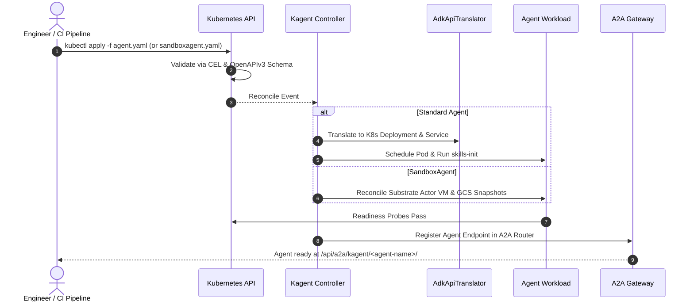

# Kagent Architecture & Kubernetes Deployment Guide

**Kagent** is a Kubernetes-native framework designed to build, deploy, manage, and scale AI agents on Kubernetes clusters. It brings declarative GitOps patterns to AI agent orchestration by treating agents, prompt instructions, tool integrations, LLM providers, and sandboxed execution harnesses as first-class Kubernetes Custom Resources.

---

## 1. High-Level Architecture Overview

At its core, Kagent decouples agent logic and tool integrations from underlying infrastructure. It transforms declarative Kubernetes Custom Resource Definitions (CRDs) into fully managed, scalable Kubernetes workloads (`Deployments`, `Services`, `ConfigMaps`, `Secrets`, `SandboxAgent` Substrate Actors, and `AgentHarness` micro-VMs).

```mermaid
flowchart TD
    subgraph Users & Interfaces
        UI["Web UI (Next.js)"]
        CLI["kagent CLI"]
        IDE["IDE Extensions (Cursor / Claude Code via MCP)"]
    end

    subgraph Kubernetes Control Plane
        CRD["Agent CRDs\n(kagent.dev/v1alpha2)"]
        CTRL["Kagent Controller (Go)\n• Reconciler & Translator\n• SandboxAgent & Substrate Controller"]
        HTTP["HTTP Server & A2A Gateway (Go)\n• REST & SSE Endpoints\n• A2A Protocol Router\n• IDE /mcp Gateway"]
    end

    subgraph Persistence & Infrastructure
        DB[("PostgreSQL\n• Sessions & Chat History\n• Checkpoints & Traces")]
        K8S_SEC["Kubernetes Secrets\n• LLM API Keys\n• Slack/Telegram Tokens"]
        GCS[("GCS Bucket\n• Actor Memory Snapshots\n(gs://ate-snapshots)")]
    end

    subgraph Workload Namespace (e.g., kagent)
        subgraph Standard Agent Pod (Agent)
            INIT["skills-init (Init Container)\n• Pulls Skill Images & Git Repos"]
            RUNTIME["ADK Runtime (Go / Python)\n• Agent Loop & LLM Client\n• MCP Tool Executor"]
        end

        subgraph BYO Agent Pod
            BYO_APP["User Custom Agent Image\n(LangGraph, CrewAI, AutoGen)"]
        end

        subgraph Agent Substrate / Sandbox
            ATE["ate-api Control Plane"]
            WORKER_POOL["WorkerPool (ate.dev)\n• Compute Capacity"]
            SBOX_AGENT["SandboxAgent Actor VM\n• Subsecond Cold-Start\n• Domain Egress Restrictions"]
            HARNESS_VM["AgentHarness Actor VM\n(OpenClaw / Hermes)"]
        end

        subgraph MCP Tool Servers
            KMCP["MCPServer Pods (KMCP)\n(Kubernetes, Helm, Cilium, etc.)"]
            REMOTE["RemoteMCPServer\n(External HTTP/SSE MCP APIs)"]
        end
    end

    UI --> HTTP
    CLI --> HTTP
    IDE --> HTTP
    HTTP --> CTRL
    HTTP --> DB
    
    CRD --> CTRL
    CTRL -->|Reconciles Deployment| Standard Agent Pod
    CTRL -->|Reconciles BYO| BYO Agent Pod
    CTRL -->|Reconciles Substrate| ATE
    ATE --> SBOX_AGENT
    ATE --> HARNESS_VM
    SBOX_AGENT <-->|Snapshots| GCS
    HARNESS_VM <-->|Snapshots| GCS
    WORKER_POOL -.->|Compute| SBOX_AGENT
    WORKER_POOL -.->|Compute| HARNESS_VM

    RUNTIME -->|LLM Calls| LLM["LLM Providers\n(OpenAI, Anthropic, Gemini, Ollama)"]
    RUNTIME -->|MCP Protocol| KMCP
    RUNTIME -->|MCP Protocol| REMOTE
    
    RUNTIME <-->|A2A Protocol| BYO_APP
```

---

## 2. Core System Components

Kagent consists of four primary architectural layers:

### A. Kubernetes Controller (`go/core/internal/controller`)
Written in Go using `controller-runtime`, the controller acts as the central operator responsible for reconciling Kagent CRDs:
* **`AgentController`**: Watches `Agent` resources and invokes the `AdkApiTranslator` to materialize or update target `Deployments`, `Services`, `ConfigMaps`, and `ServiceAccounts`.
* **`SandboxAgentController`**: Reconciles `SandboxAgent` resources onto Agent Substrate actor micro-VMs, configuring network domain security and snapshot policies.
* **`AgentHarnessSubstrateController`**: Manages the lifecycle of Substrate sandboxed micro-VM actor environments for interactive shells and messenger bots (`AgentHarness`).
* **`ModelConfigController`**: Reconciles LLM provider configurations and resolves referenced Kubernetes `Secrets` containing API tokens.
* **`RemoteMCPServerController` & `MCPServerToolController`**: Manages tool server availability, endpoint discovery, and secret bindings for Model Context Protocol (MCP) integrations.

### B. Agent Development Kit (ADK) & Runtimes (`go/adk` & `python/packages/kagent-*`)
Kagent provides built-in ADK runtimes that run inside agent pods or sandbox actor VMs:
* **Go ADK (`runtime: go`)**: Lightweight, high-performance runtime written in Go with fast cold-start times.
* **Python ADK (`runtime: python`)**: Full-featured Python runtime supporting complex agent tool pipelines, streaming, and code execution.

### C. HTTP Server & A2A Gateway (`go/core/internal/httpserver`)
* **A2A (Agent-to-Agent) Router**: Serves `/api/a2a/<namespace>/<agent-name>/` endpoints for inter-agent communication.
* **MCP Gateway (`/mcp`)**: Exposes cluster agents directly as MCP tools to external IDEs (Cursor, Claude Code, Windsurf).

### D. Persistence Layer
* **PostgreSQL Database**: Stores multi-turn session histories, execution checkpoints, and agent metrics.
* **Google Cloud Storage (GCS)**: Stores golden and incremental memory snapshots for Agent Substrate actors (`gs://ate-snapshots/...`).
* **Kubernetes Secrets**: Securely stores API keys for LLM providers and messenger integrations.

---

## 3. Kubernetes Custom Resource Definitions (CRDs)

Kagent defines API resources under the `kagent.dev/v1alpha2` API group:

| CRD Kind | Description | Primary Use Case |
| :--- | :--- | :--- |
| **`Agent`** | Standard declarative or BYO agent | Production workloads deployed as standard K8s Pods / Deployments |
| **`SandboxAgent`** | Agent running on Agent Substrate | High-security, sandboxed code execution with fast cold-starts & domain restrictions |
| **`AgentHarness`** | Sandboxed execution VM environment | Interactive shell environments (OpenClaw/Hermes) with Slack/Telegram bot integration |
| **`ModelConfig`** | LLM provider abstraction | Reusable model credentials & parameters (OpenAI, Gemini, Anthropic) |
| **`RemoteMCPServer`** | MCP Tool integration | Connecting agents to external or in-cluster MCP tool servers |

---

## 4. Comparing Agent Execution Workloads

```
 ┌─────────────────────────┐  ┌─────────────────────────┐  ┌─────────────────────────┐
 │        Agent            │  │      SandboxAgent       │  │      AgentHarness       │
 │  (Standard Pod/Deployment)│  │ (Substrate Micro-VM)    │  │ (Interactive Shell/Bot) │
 └────────────┬────────────┘  └────────────┬────────────┘  └────────────┬────────────┘
              │                            │                            │
              ▼                            ▼                            ▼
  Kubernetes Pod / Container    Agent Substrate Actor VM     Agent Substrate Actor VM
  • Ephemeral Pod storage       • GCS Memory Snapshots       • GCS Memory Snapshots
  • Standard K8s RBAC           • Egress Domain Rules        • Slack/Telegram Channels
```

| Feature | `Agent` | `SandboxAgent` | `AgentHarness` |
| :--- | :--- | :--- | :--- |
| **Underlying Primitive** | Kubernetes `Deployment` / `Pod` | Substrate `Actor` VM (`ate.dev`) | Substrate `Actor` VM (`ate.dev`) |
| **Cold-Start Speed** | Standard container pull/start | Sub-second (via snapshot restore) | Sub-second (via snapshot restore) |
| **Memory Persistence** | Ephemeral Pod | GCS Golden Snapshots (`gs://`) | GCS Golden Snapshots (`gs://`) |
| **Network Egress Control** | Standard K8s NetworkPolicies | Granular `allowedDomains` filtering | Configurable sandbox network |
| **Messenger Integration** | Via A2A or REST API | Via A2A or REST API | Direct Slack & Telegram bot bindings |

---

## 5. Agent Substrate & `SandboxAgent` Deep-Dive

### A. What is `SandboxAgent`?
A **`SandboxAgent`** (`kagent.dev/v1alpha2`) is an AI agent that executes inside an isolated **Agent Substrate Actor VM** rather than a standard Kubernetes Pod. 

It combines the full declarative power of `AgentSpec` (prompts, model configs, MCP tools) with Substrate's secure sandboxing features:
1. **Subsecond Cold-Starts**: Uses golden actor memory snapshots (`gs://ate-snapshots`) to pause, resume, and restore agent states instantly.
2. **Network Domain Whitelisting (`spec.sandbox.network.allowedDomains`)**: Restricts outbound network calls made by Python/Go code interpreter tools running inside the agent.
3. **No Unneeded Kubernetes RBAC**: The agent runs inside an isolated micro-VM sandbox without direct access to the cluster's node or API server unless explicitly granted.

### B. `SandboxAgent` Deployment Example

Here is a production-ready manifest for a **`SandboxAgent`**:

```yaml
apiVersion: kagent.dev/v1alpha2
kind: SandboxAgent
metadata:
  name: secure-code-interpreter-agent
  namespace: kagent
spec:
  type: Declarative
  description: "Sandboxed agent capable of executing Python code with strict domain whitelisting"
  declarative:
    runtime: python
    modelConfig: default-model-config
    stream: true
    systemMessage: |
      You are a secure code analysis assistant.
      You can write and execute Python code to analyze data.
    tools:
      - type: McpServer
        mcpServer:
          kind: RemoteMCPServer
          apiGroup: kagent.dev
          name: kagent-tool-server
          namespace: kagent
          toolNames:
            - datetime_get_current_time
  # Substrate actor engine settings
  substrate:
    workerPoolRef:
      name: default-worker-pool              # References existing ate.dev WorkerPool
    snapshotsConfig:
      location: gs://ate-snapshots/kagent/secure-code-interpreter-agent
  # Network sandbox isolation rules
  sandbox:
    network:
      allowedDomains:
        - "api.openai.com"
        - "pypi.org"
        - "files.pythonhosted.org"
```

#### Deploying and Verifying `SandboxAgent`:
```bash
# 1. Apply the SandboxAgent manifest
kubectl apply -f sandbox-agent.yaml

# 2. Check SandboxAgent status
kubectl get sandboxagent -n kagent

# Output:
# NAME                             READY   ACCEPTED
# secure-code-interpreter-agent   True    True

# 3. Invoke the SandboxAgent via kagent CLI
kagent invoke -t "Write a python script to calculate Fibonacci numbers up to 100" --agent secure-code-interpreter-agent
```

---

## 6. Agent Substrate & `AgentHarness` Deep-Dive

### A. What is `AgentHarness`?
An **`AgentHarness`** (`kagent.dev/v1alpha2`) is a dedicated remote execution micro-VM powered by Substrate (using backends like **OpenClaw** or **Hermes**). Unlike `SandboxAgent` (which runs a single agent loop), `AgentHarness` provides an interactive execution environment with direct model gateway injection and messaging channel bindings (Slack/Telegram).

### B. `AgentHarness` Deployment Example

```yaml
apiVersion: kagent.dev/v1alpha2
kind: AgentHarness
metadata:
  name: ops-sandbox-harness
  namespace: kagent
spec:
  backend: openclaw
  description: "Isolated OpenClaw execution harness with Slack channel integration"
  modelConfigRef: default-model-config
  substrate:
    workerPoolRef:
      name: default-worker-pool
    snapshotsConfig:
      location: gs://ate-snapshots/kagent/ops-sandbox-harness
  channels:
    - name: slack-ops
      type: slack
      slack:
        botToken:
          valueFrom:
            secretKeyRef:
              name: harness-slack-secret
              key: bot-token
        appToken:
          valueFrom:
            secretKeyRef:
              name: harness-slack-secret
              key: app-token
        openclaw:
          channelAccess: open
          interactiveReplies: true
```

---

## 7. Lifecycle of Agent Creation & Deployment



---

## 8. Multi-Agent Collaboration via A2A Protocol

Kagent uses the open **A2A (Agent-to-Agent)** protocol to enable autonomous collaboration between agents across the cluster:
1. **Discovery**: Agents query `.well-known/agent.json` of other agents in allowed namespaces (`spec.allowedNamespaces`).
2. **Invocation**: An agent delegates sub-tasks to specialized agents via JSON-RPC / REST over A2A.

---

## 9. Security & Isolation Summary

* **Standard Pod Execution (`Agent`)**: Non-root container security context with standard Kubernetes RBAC.
* **Substrate Micro-VM Execution (`SandboxAgent` & `AgentHarness`)**: Micro-VM actor sandboxing with strict domain network egress rules (`allowedDomains`) and GCS golden state snapshots.
* **Secret Decoupling**: Credentials (LLM API keys, Slack tokens) are kept strictly in Kubernetes `Secrets`.

---

## Summary Deployment Checklist

1. **Create LLM API Key Secret**: `kubectl create secret generic openai-secret --from-literal=api-key=$OPENAI_API_KEY -n kagent`
2. **Apply ModelConfig**: `kubectl apply -f modelconfig.yaml`
3. **Deploy Choice of Workload**:
   * Standard Pod Agent: `kubectl apply -f agent.yaml`
   * Substrate Sandbox Agent: `kubectl apply -f sandbox-agent.yaml`
   * Substrate Interactive Harness: `kubectl apply -f agent-harness.yaml`
4. **Invoke & Monitor**: `kagent invoke -t "Your prompt" --agent <agent-name>` or view via `kagent dashboard`.
